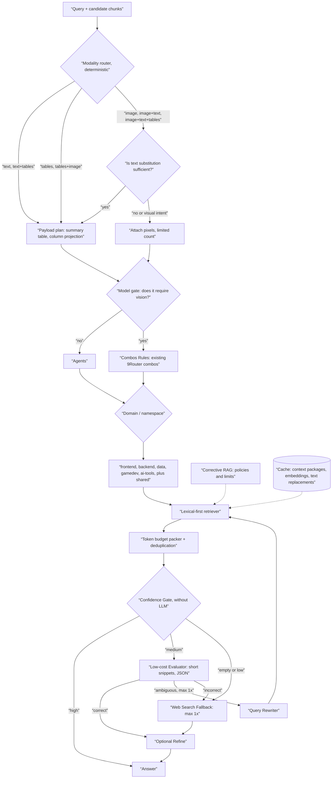

# Pipeline Specifications — Token-Efficient RAG

Reference: `Flowchart_AI_SMART_TOKEN_drawio.svg`. Execution verification: `reference/ragCore.reference.cjs` and its 20 tests.

## 1. Reading the Flowchart

The sections **included in the flowchart** and those **added by this PRD** are distinguished so that the owner can reject the additions.

| Node in the flowchart | Read as | Specification |
|---|---|---|
| RAG Efficiency Token | Pipeline entry point | FR-1 |
| Text Chunks → If/Else → Text+Tables, Text | Text path | §3 |
| Image/Chart → If/Else → Image+Text, Image+Text+Tables, Image | Image path | §3 |
| Image/Chart → If/Else → Tables+Image, Tables | Table path | §3 |
| 7 leaves merge → Model | **Model gateway**: text-only or requires vision (assumption, PRD §14 Q2) | §4 |
| Corrective RAG → Retriever | Correction policy wraps retrieval | §8 |
| Combos Rules | Existing 9Router combos; not reimplemented. **Only paths requiring vision are traversed**, then directly to Domain / namespace | §4 |
| Agents → if/else → Frontend, Backend, SQL/NoSQL, GAMEDEV, AI/AI Tools | Text-only paths enter **Agents** directly, followed by namespace selection. Vision paths pass through Combos Rules and merge into the Domain / namespace | `AGENT_INTEGRATION.md` §3 |
| Retriever → if/else → Direct Answer | **Confidence gate** (read from the if/else before Answer) | §7 |
| Evaluator → if/else → Correct / Ambiguous / Incorrect | Three-status evaluator | §8 |
| Correct → Answer | Answer (optional refinement) | §8 |
| Ambiguous → Query Rewriter | Rewrite, re-retrieve (max 1x) | §8 |
| Incorrect → Web Search Fallback | Max 1x, can be disabled | §8 |

**Added by this PRD (not shown in the flowchart):** surrogate-first for images, table column projection, budget packer + deduplication, loop exit path (call limit), refine, cache, telemetry, secret hygiene.

**Ambiguities interpreted with the following assumptions:** (a) the meaning of the “Model” node; (b) Query Rewriter and Web Search Fallback have no outgoing arrows; they are assumed to return to Retriever and to Answer; (c) a single unlabeled if/else statement before Answer is interpreted as a confidence gate.

## 2. Optimized Flowchart

Image version (rendered version of the diagram below): `pipeline-optimized.png`.

## 3. Payload Plan by Modality Class

| Class | Text | Tables | Images |
|---|---|---|---|
| `text` | Send | — | — |
| `text+tables` | Send prose | Concise + columnar projection | — |
| `tables` | — | Summary + column projections | — |
| `tables+image` | — | Summary | **Skip** unless intended for visual presentation (tables are cheaper and more precise than graphs) |
| `image` | — | — | Text substitute; pixels only if visual gate passes |
| `image+text` | Send prose | — | Text substitute; pixels only if visual gate passes |
| `image+text+tables` | Send prose | Summary | Text substitute; pixels only if visual gate passes |

**Visual gate** (`needsVisual`): pixels are included if (1) there is no text alternative, or (2) the confidence of the alternative is < the threshold, or (3) the query contains a visual intent (color, layout, position, appearance, screenshot, mockup, graphic, chart, diagram, pixel, sprite, icon, and the like).

**Image cost:** Calculated based on size when known. Example formula from Claude’s vision documentation: width × height / 750 tokens; other providers may differ, so adjust based on actual usage in 9Router. If the size is unknown, use a configurable conservative value.

## 4. Model and Combo Gates

- The model gate produces only one fact: `needsVision` (yes/no). It does not select a model.
- **`needsVision` = no:** proceeds directly to Agents. The Agent uses its domain’s built-in combo (`AGENT_INTEGRATION.md` §3), without going through the Combos Rules.
- **`needsVision` = yes:** goes through the Combos Rules to select a vision combo, then proceeds directly to the Domain/namespace. This revision to the flow stems from the owner’s review of the diagram; it was interpreted that Agents are no longer traversed by the vision path (confirmed in PRD §14 Q9).
- Combos are selected by the caller via existing combo names (`ui-vision-combo` for vision; domain-specific text combos). Order, fallback, and cost are managed by 9Router and the PRD `9router-cost-routing`.
- Integration occurs only via HTTP to the 9Router endpoint. No code is added to `9router/`.

## 5. Table Serialization

- Default format: `Header1|Header2|...` once, followed by one row per data entry, with spaces in cells normalized.
- Column projection: The first column is always retained. Other columns are retained if their headers match words in the query. **If no other columns match, all columns are retained** (no guessing).
- Default row limit is 40; excess rows are indicated as `[+N rows not shown]`.
- Never modify the contents of cells containing numbers, codes, paths, or error messages.
- Table chunking during ingestion: per table, group rows by repeating headers, rather than per row without headers.

## 6. Budget Packer

1. Sort candidates by score per token (tie-breaker: id).
2. Reject near-duplicates (Jaccard shingle of 3 words ≥ 0.8).
3. Add items until the budget is exhausted. The first item that exceeds the budget is still included and marked as `overBudget`.
4. Sort the results by ID to ensure consistency across requests (to assist the prefix cache provider).

Initial budget (tuned in Phase 1): `simple` 1,500, `coding` 3,000, `complex` 6,000 context retrieval tokens; image tokens are counted separately with a limit on the number of images.

## 7. Confidence Gate

Input: packaged results, normalized scores from 0 to 1, query keywords.

| Condition | Route |
|---|---|
| No results | `incorrect` |
| Top score ≥ 0.75 **and** keyword coverage ≥ 0.8 | `answer` (evaluator skipped) |
| Top score < 0.25 **and** coverage 0 | `incorrect` |
| Other | `evaluate` |

Key terms: quoted phrases, filenames, camelCase/snake_case identifiers, and numbers with ≥ 2 digits. Terms that are merely substrings of other terms are discarded so that `jwtConfig.js` is not counted twice (this flaw was discovered and fixed during reference verification). Thresholds are fine-tuned starting points from the evaluation set and validated via shadow mode (`TEST_PLAN.md` §4).

## 8. Corrective RAG Loop

| State | Action | Limit |
|---|---|---|
| `answer` gate | Answer directly | 0 additional model calls |
| `evaluate` gate | Evaluator → `correct` / `ambiguous` / `incorrect` | evaluator ≤ 2 |
| `correct` | Optional refinement, respond | — |
| `ambiguous`, rewrite not yet used | Rewrite → re-retrieve → gate/evaluation | rewriter ≤ 1 |
| `ambiguous` after rewrite, or `incorrect` | Web fallback if `allowWeb`; otherwise, respond with `lowConfidence` | web ≤ 1 |
| Evaluator error | Fail-open: proceed with original context, `evaluatorFailed` | — |
| Rewriter/web error | Keep original query / respond with `lowConfidence` | — |

Maximum total additional model calls per request: 2 evaluators + 1 rewriter + 1 web = 4, with a default of 0.

**Refine (additional PRD):** Remove irrelevant sentences from the selected chunk before the response. Optional and only after evaluation; must not modify code, paths, or error messages.

## 9. Cache

| Cache | Key | Invalidation |
|---|---|---|
| Context package | namespace + normalized query + corpus hash | Corpus hash changes |
| Embedding | chunk hash | Chunk changes |
| Image text substitute | image hash | Image changes |

The existing Redis in the backend is used for product features; local file indexes are used for the CLI agent. Cache failure = bypass cache.

## 10. Telemetry and Reason Codes

Fields: `correlationId`, `namespace`, `modalityClass`, `tokensByStage`, `gateRoute`, `calls {evaluate, rewrite, web}`, `cacheHit`, `pixelsAttached`, `reason`. Reason codes: `high_confidence_direct`, `middle_band_evaluate`, `no_results`, `table_covers_image`, `surrogate_used`, `visual_intent`, `no_surrogate`, `rewrite_once`, `web_fallback`, `web_disabled`, `evaluator_failed_open`, `over_budget_single_item`. No thought chains and no full prompts.

## 11. Example Paths

| Query | Path | Additional Model Calls |
|---|---|---|
| “Explain `jwtConfig.js`” and retrieval finds `jwtConfig.js` with a score of 0.95 | gate → `answer` | 0 |
| “Explain `jwtConfig.js` and `roleModel.js`” and only one is covered | gate → `evaluate` → `ambiguous` → rewrite → re-retrieve → `correct` | 1–2 evaluators + 1 rewriter |
| Topic with no results in the corpus | gate → `incorrect` → web (if allowed) | 1 web |
| Topic with no results, web disabled | `uncertain` with `lowConfidence` | 0 |
